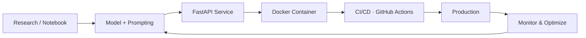

<div align="center">


<br/>


</div>

---

## 👋 About Me

```bash
$ whoami
> Dhaksin S, AI Forward Deployed Engineer

$ cat mission.txt
> I take AI models out of notebooks and put them in front of real users.
> Deploy. Monitor. Optimize. Repeat.

$ echo $QUOTE
> "Models don't matter until they're deployed."
```

- 🔭 Deploying, monitoring and optimizing **LLM and RAG systems** in production
- 🌱 Currently learning **Agentic AI, LLM Fine-tuning and Distributed Inference**
- 🤝 Open to **AI collabs, open-source ML and GenAI projects**
- 🎓 B.E. Computer Science & Engineering, **St. Joseph's College of Engineering, Chennai**
- 📍 Chennai, Tamil Nadu, India 🇮🇳
- 📫 Reach me at **dhaksin53@gmail.com**

---

## 🧭 What I Do

<table>
<tr>
<td width="33%" valign="top">

### 🧠 LLMs & RAG
Building retrieval pipelines, prompt workflows and LLM-powered apps that hold up outside the demo.

</td>
<td width="33%" valign="top">

### ⚙️ MLOps
Containerizing, automating and monitoring models so they keep working after launch.

</td>
<td width="33%" valign="top">

### 🚀 Field Deployment
Working directly with real environments and users to get AI live and performing.

</td>
</tr>
</table>

---

## 🛠️ Tech Stack

<div align="center">

**AI / ML**


**Deploy / Infra**


**Full Stack**


</div>

---

## 🧱 How I Ship AI



---

## 💼 Experience

```log
[2025 → now]  AI Forward Deployed Engineer
              Deploying, monitoring & optimizing AI models in production
              LLMs · MLOps · RAG · Field Engineering

[2024]        ML Engineer Intern · CODSOFT
              Built fraud detection, cancer prediction & stock classifiers
              scikit-learn · Python · Jupyter · Pandas

[2023]        Full-Stack Developer
              Built MERN apps: BookStore, Weather App & more
              MongoDB · Express · React · Node.js

[2020 → 2024] B.E. Computer Science & Engineering
              St. Joseph's College of Engineering, Chennai
```

---

## 🎯 Currently Leveling Up


---

## 📊 GitHub Stats

<div align="center">


<br/>


<br/>


</div>

---

## 🤝 Let's Build Something

<div align="center">

[](https://www.linkedin.com/in/dhaksin-s-726320256)
[](mailto:dhaksin53@gmail.com)
[](https://github.com/Dhaksin53)

*Got an AI idea stuck in a notebook? Let's get it deployed.* 🚀

</div>


